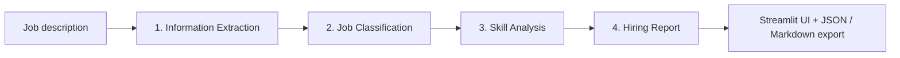

# JobLens AI

**Turn any job description into a structured hiring brief.**

JobLens AI is an AI-powered job description analyzer built with Streamlit and LangGraph. Paste a job posting and get a structured report with the role, experience requirements, technical and soft skills, top priorities, responsibilities, and qualifications, all exportable as JSON or Markdown.

<!-- Add a screenshot of the app here -->
<!--  -->


---

## Features

- **Information extraction:** job title, company, required experience, and required skills
- **Job classification:** category, employment type, and work arrangement (remote, hybrid, on-site)
- **Skill analysis:** technical skills separated from soft skills
- **Priority ranking:** the top three skills to focus on
- **Responsibilities and qualifications:** pulled out of the posting as clean lists
- **Summary:** a short, recruiter-friendly overview of the role
- **Export:** download the report as JSON or Markdown
- **Sample job posts** to try the app instantly
- **Built-in error handling:** missing API keys, invalid input, rate limits, and unavailable models each show a clear message
- **Validated output:** every report is checked with Pydantic before it is shown

---

## How it works

JobLens AI runs a four-node LangGraph workflow. Each node reads from and writes to a shared state, and the final report is validated before it reaches the UI.



| Step | Node | Output |
|------|------|--------|
| 1 | Information Extraction | Job title, company, experience, required skills |
| 2 | Job Classification | Category, employment type, work arrangement |
| 3 | Skill Analysis | Technical skills, soft skills, top three priorities |
| 4 | Hiring Report | Summary, responsibilities, qualifications, validated report |

---

## Tech stack

| Component | Technology |
|-----------|-----------|
| UI | Streamlit |
| Workflow orchestration | LangGraph |
| Data validation | Pydantic |
| LLM providers | Groq API, Google Gemini API |
| Configuration | python-dotenv |

---

## Project structure

```text
JobLens_AI_Streamlit/
├── app.py                 # Streamlit UI and report rendering
├── joblens/
│   ├── __init__.py
│   ├── schemas.py         # Pydantic models for the report
│   └── workflow.py        # LangGraph workflow and LLM calls
├── .env.example           # Environment variable template
├── .gitignore
├── requirements.txt
└── README.md
```

---

## Getting started

### Prerequisites

- Python 3.10 or newer
- An API key from [Groq](https://console.groq.com/keys) **or** [Google AI Studio](https://aistudio.google.com/)

### 1. Clone the repository

```bash
git clone https://github.com/<your-username>/JobLens_AI_Streamlit.git
cd JobLens_AI_Streamlit
```

### 2. Create and activate a virtual environment

**Windows (PowerShell):**

```powershell
py -m venv .venv
.\.venv\Scripts\Activate.ps1
```

**macOS / Linux:**

```bash
python3 -m venv .venv
source .venv/bin/activate
```

> **PowerShell blocks activation?** Run `Set-ExecutionPolicy -Scope Process -ExecutionPolicy Bypass`, then activate again.

### 3. Install dependencies

```bash
python -m pip install --upgrade pip
pip install -r requirements.txt
```

### 4. Configure environment variables

Copy the template and add your key:

```bash
cp .env.example .env          # Windows PowerShell: Copy-Item .env.example .env
```

Example `.env` for Groq:

```env
LLM_PROVIDER=groq
GROQ_API_KEY=your_groq_api_key_here
LLM_MODEL=llama-3.3-70b-versatile
```

Example `.env` for Gemini:

```env
LLM_PROVIDER=gemini
GEMINI_API_KEY=your_gemini_api_key_here
LLM_MODEL=gemini-2.5-flash
```

### Configuration reference

| Variable | Required | Default | Description |
|----------|----------|---------|-------------|
| `LLM_PROVIDER` | No | `groq` | `groq` or `gemini` |
| `GROQ_API_KEY` | If using Groq | — | Groq API key |
| `GEMINI_API_KEY` | If using Gemini | — | Google Gemini API key |
| `LLM_MODEL` | No | Provider default | Model name available to your API account |

> Model names change over time. If you see a "model not found" error, pick a model your account currently supports and update `LLM_MODEL`.

### 5. Run the app

```bash
streamlit run app.py
```

Streamlit opens the app at `http://localhost:8501`. Restart the app after changing `.env`.

---

## Usage

1. Paste a job description, or click a sample to load one (minimum 40 characters, maximum 15,000).
2. Click **Analyze job description**.
3. Review the report: role summary, priority skills, skill groups, responsibilities, and qualifications.
4. Export the result with **Download JSON** or **Download Markdown**.

---

## Deploying on Streamlit Community Cloud

1. Push the repository to GitHub (keep `.env` out of version control).
2. Create a new app on [share.streamlit.io](https://share.streamlit.io) and select `app.py` as the entry point.
3. In the app settings, open **Secrets** and add:

```toml
LLM_PROVIDER = "groq"
GROQ_API_KEY = "your_groq_api_key_here"
LLM_MODEL = "llama-3.3-70b-versatile"
```

The app reads these Streamlit secrets automatically, so no code change is needed.

---

## Troubleshooting

| Problem | Solution |
|---------|----------|
| `GROQ_API_KEY is missing` | Check `.env` (or Streamlit secrets) and restart the app. |
| API key rejected | Verify the key and remove any extra spaces or quotes. |
| Rate limit or quota error | Wait a few minutes, or check your provider's usage limits. |
| Model not found (404) | Set `LLM_MODEL` to a model currently available to your account. |
| Packages not found | Make sure `.venv` is activated, then run `pip install -r requirements.txt` again. |
| PowerShell won't activate `.venv` | Run `Set-ExecutionPolicy -Scope Process -ExecutionPolicy Bypass`. |

---

## Roadmap

- [ ] Support for scanned PDF uploads via OCR
- [ ] Side-by-side comparison of multiple job descriptions
- [ ] Skill gap analysis against a candidate's resume
- [ ] Docker support
- [ ] Automated tests for the workflow nodes

---

## Limitations

- AI output may be incomplete or inaccurate. Always verify details against the original posting.
- JobLens AI analyzes job descriptions only. It does not rank or evaluate candidates.
- Image-only PDFs have no extractable text. Paste the content manually in that case.

---

## Contributing

Contributions, issues, and feature requests are welcome. To contribute:

1. Fork the repository
2. Create a feature branch (`git checkout -b feature/your-feature`)
3. Commit your changes (`git commit -m "Add your feature"`)
4. Push the branch (`git push origin feature/your-feature`)
5. Open a pull request

---

## License

This project is licensed under the MIT License. See the [LICENSE](LICENSE) file for details.

---

## Author

**Rameesha Fatima**
AI & Data Science learner · Karachi, Pakistan
[GitHub](https://github.com/<your-username>) · [Email](mailto:rameeshaf8@gmail.com)

If you found this project useful, consider giving it a star ⭐
